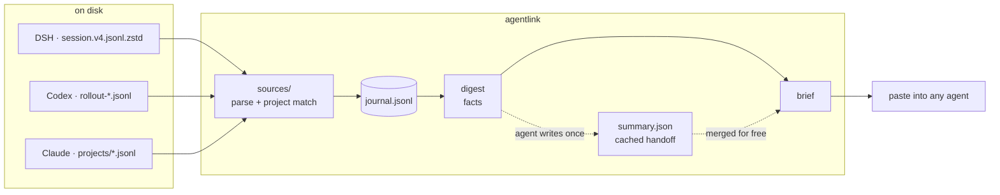
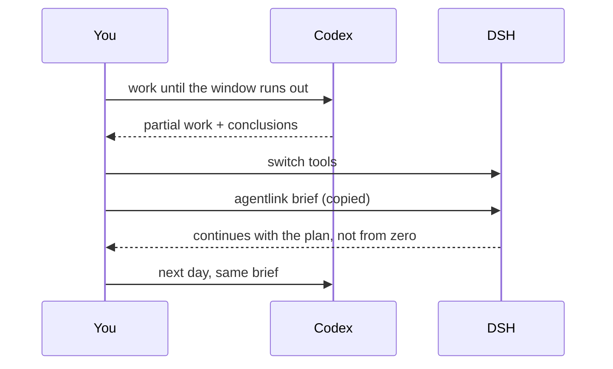
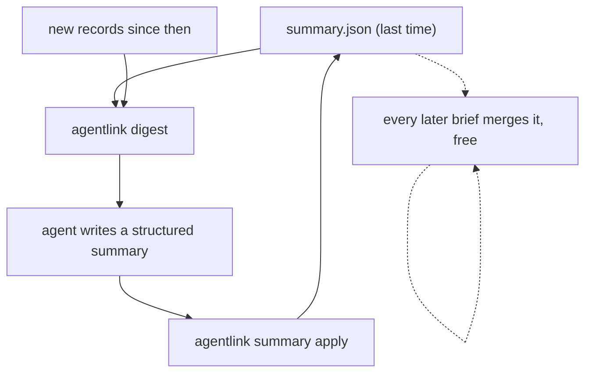
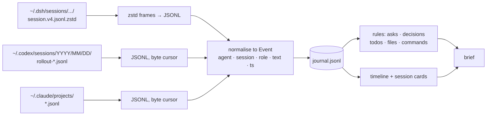

# agentlink

**Switch agents. Keep the plot.** One project, three tools — DSH, Codex (ChatGPT), Claude Code.

[](https://github.com/gougougouz/agent-context-bridge/actions/workflows/ci.yml)
[](https://www.python.org/)
[](LICENSE)

English · [简体中文](README.zh-CN.md)

---

You finish a Codex session, hit the usage ceiling, and open DSH to keep going. The first
thing it asks is what you are working on. So you explain the project again. Then you
explain why you picked CSV over XLSX. Then you go looking for the file you had open two
minutes ago.

All three tools keep transcripts — just in different places, in different formats. They
never talk to each other. `agentlink` reads those transcripts from disk, keeps what belongs
to the current project, and prints a single brief you can hand to whichever agent you are
talking to now.

```console
$ agentlink brief

# Project context · payments-service
> 4 sessions / 812 records (DSH, Codex, Claude; 2 days ago → 12 min ago)

## 1. Handoff summary (written by an agent)
- Goal: move settlement off cron batches onto event-driven consumers
- Status: core path migrated, rollback switch not built yet
- In progress: idempotency key write path. Next: reconciliation job, rollback flag

## 2. Current asks (newest first)
- 12 min ago (Codex): don't touch reconciliation yet, get idempotency passing first

## 3. Session cards
### Codex · idempotency keys (last active 12 min ago)
- Ask: composite key or uuid?
- Last conclusion: business_id+date, Redis lock on conflict
- Files: src/ledger/idempotency.py, migrations/007_idem.sql
- Commands: pytest tests/test_idempotency.py
```

## The idea

Two layers, on purpose.

**Facts are cheap.** Git state, your recent requests, decisions and TODOs pulled out by
keyword, files and commands touched. Deterministic, offline, no model involved.

**Meaning is expensive, so it is cached.** When a handoff really matters, an agent reads
the facts, writes a structured summary once, and every later brief merges it — in all three
tools — for free.



Nothing leaves your machine. There is no API key to configure, and the only network call in
the whole project is the installer downloading the repository.

## Install

Windows, PowerShell:

```powershell
irm https://raw.githubusercontent.com/gougougouz/agent-context-bridge/main/install.ps1 | iex
```

macOS / Linux:

```bash
curl -fsSL https://raw.githubusercontent.com/gougougouz/agent-context-bridge/main/install.sh | bash
```

The script downloads the code, installs `zstandard` if it is missing, copies `SKILL.md` into
the three skill directories, and puts an `agentlink` launcher on your PATH. Run it again to
upgrade; it replaces the code and leaves your projects untouched.

| What it touches | Where |
| --- | --- |
| code | `%LOCALAPPDATA%\agentlink` (Windows), `~/.local/share/agentlink` (macOS/Linux) |
| DSH skill | `~/.dsh/skills/agent-context-bridge/` |
| Codex skill | `~/.codex/skills/agent-context-bridge/` |
| Claude skill | `~/.claude/skills/agent-context-bridge/` |
| launcher | `~/.../bin/agentlink` + a PATH entry pointing at it |

Pick a different location if you like:

```powershell
& ([scriptblock]::Create((irm https://raw.githubusercontent.com/gougougouz/agent-context-bridge/main/install.ps1))) -Dir D:\app\agentlink
```

```bash
curl -fsSL .../install.sh | AGENTLINK_HOME=/opt/agentlink bash
```

Then restart the tools, or open a new session, so they notice the skill. `agentlink doctor`
tells you what it can see:

```console
$ agentlink doctor
agentlink 0.2.0
Python      : D:\PythonEnv\python.exe (3.12.15)
zstandard   : 0.25.0
git         : F:\app\tools\git\cmd\git.exe

DSH             skill installed  ~/.dsh/skills/agent-context-bridge
                transcripts OK   ~/.dsh/sessions
Codex (ChatGPT) skill installed  ~/.codex/skills/agent-context-bridge
                transcripts OK   ~/.codex/sessions
Claude Code     skill installed  ~/.claude/skills/agent-context-bridge
                transcripts MISSING  ~/.claude/projects
```

## First five minutes

```console
$ cd ~/code/payments-service
$ agentlink init

Initialised state dir: ~/code/payments-service/.agentlink
  - DSH: 1 session, 137 records
  - Codex (ChatGPT): 8 sessions, 2182 records
Total: 9 sessions, 2319 records

Next: run `agentlink brief`, and `agentlink hook` if you want new sessions to notice it.
```

```console
$ agentlink brief            # the thing you paste
$ agentlink note "CSV only, xlsx next iteration" --kind decision
Recorded [decision]: CSV only, xlsx next iteration
$ agentlink hook             # optional: a pointer in AGENTS.md / CLAUDE.md
```

`init --hook` does both setup steps at once (used by people who want the agents to bring the
context up on their own).

After that, the loop is short enough to remember:



## Usage, by situation

**Quota ran out mid-task.** `agentlink brief` — the new agent gets the current ask, the last
conclusion, the files involved and the open TODOs. If the hand-off is subtle, say so; the
agent will write the cached summary once (`agentlink digest` → JSON → `summary apply`) and
the next switch reuses it.

**Working on something for a week.** Run `agentlink brief --since 3d` to keep the brief
focused, or `--full` when you want the timeline and git log as well. `agentlink status`
tells you whether the cached summary is still fresh.

**Not sure what happened yesterday.** `agentlink show --since yesterday --role user` lists
the requests; `agentlink show --session 4f2a` gives you one session in full.

**Two people, three tools, one repo.** `.agentlink/` is git-ignored, so state stays local.
If you want a teammate to get the same handoff, they run `agentlink brief` themselves — the
facts come from their own transcripts, the summary from the shared repository history.

## Commands

| Command | What it does |
| --- | --- |
| `agentlink init [--hook]` | create `.agentlink/`, pull existing sessions, optionally write the `AGENTS.md` pointer |
| `agentlink sync` | pull new records (implicit in most other commands) |
| `agentlink brief` | print the brief. `--full`, `--budget-tokens N`, `--since 3d`, `--out FILE`, `--copy`, `--stats`, `--no-ai`, `--no-git` |
| `agentlink digest` | compact material for an agent to summarize (`--full`, `--max-tokens`, `--out`) |
| `agentlink summary apply -f x.json` | store a handoff summary (`show`, `clear`) |
| `agentlink note "..." --kind todo` | write a judgement all three tools will see (`note`, `decision`, `done`) |
| `agentlink status` | sources, counts, cached summary freshness, brief size |
| `agentlink show` | raw records: `--session ID`, `--role user`, `--since 3d`, `--limit N`, `--full` |
| `agentlink handoff --to claude` | write `.agentlink/HANDOFF.md` for one tool |
| `agentlink hook [--remove]` | maintain the pointer block in `AGENTS.md` / `CLAUDE.md` |
| `agentlink doctor` | dependencies, transcript directories, skill installs |
| `agentlink install [--path]` | (re)install the skill into the three directories |

Global flags: `--root DIR`, `--agent dsh,codex,claude`, `--lang en|zh`.

## What it costs

A default brief is about 2–3k tokens — a short README's worth — and it is the only thing that
enters a context window. That is usually the whole cost of switching tools.

| Tier | Command | Roughly | Use it when |
| --- | --- | --- | --- |
| L0 | `agentlink status` | 50 tokens | checking whether there is anything to sync |
| **L1** | `agentlink brief` | **~3k** | default: switching tools, "where were we" |
| L2 | `agentlink brief --full` | ~8k | you want the timeline, decisions and replay |
| L3 | `agentlink digest` → JSON → `summary apply` | 3–8k, **once** | long hand-off, multi-day work |

L3 is what keeps the whole thing affordable without cutting corners:



`digest` hands the agent the previous summary plus only the records added since, so refreshing
costs a fraction of a re-read. Refresh when `brief --stats` says it is behind, or when the
work genuinely moved on — not on every switch.

## How it works



**Project claiming.** A session belongs to the project when the `cwd` it recorded is inside
the project root (subdirectories included). Paths are normalised with `realpath`, which also
catches Windows 8.3 short names — the kind CI uses.

**Incremental reads.** Codex and Claude files only grow, so a byte offset plus a line index is
enough. DSH rewrites its session file on every turn (compressed, multi-frame), so there the
cursor is the record `seq` number.

**Noise filtering.** Runtime context, system reminders, tool-result dumps, UI control tags and
reviewer sub-threads are dropped; if a parser meets an unknown record type it skips it instead
of failing.

**Ordering.** Everything is merged by timestamp, not by which tool produced it, so a task
that bounced Codex → DSH → Claude reads as one story.

## Project state

```
your-project/
├── .agentlink/              # git-ignored, disposable
│   ├── config.json          # agents, token budgets, git toggle
│   ├── state.json           # per-file cursors, session titles, seen records
│   ├── journal.jsonl        # normalised events (rebuildable)
│   ├── notes.jsonl          # your `agentlink note` entries
│   ├── context.md           # last brief
│   ├── summary.json         # cached handoff, shared by all three tools
│   └── HANDOFF.md           # `agentlink handoff` output
├── AGENTS.md                # optional pointer, written by `agentlink hook`
└── CLAUDE.md                # same
```

Delete `.agentlink/` and the next `brief` rebuilds everything from the transcripts. Set
`AGENTLINK_STATE_DIR` if you prefer state outside the repository (useful when the project
lives on a slow or read-only mount).

## Writing a handoff summary

`agentlink digest` prints material shaped like this (trimmed):

```json
{
  "mode": "incremental",
  "previous_summary": { "project": {...}, "state": {...}, "sessions": [...] },
  "new_events": [
    { "agent": "codex", "role": "user", "ts": "...", "text": "don't touch reconciliation yet" }
  ],
  "schema_hint": { "version": 1, "fields": ["project.goal", "state.in_progress[]", "..."] }
}
```

Write it back as:

```json
{
  "version": 1,
  "project": { "goal": "one sentence", "status": "where it stands", "stack": "..." },
  "state": {
    "done": [], "in_progress": [], "blocked": [],
    "decisions": [], "next": [], "risks": []
  },
  "sessions": [
    { "agent": "codex", "id": "...", "title": "...",
      "one_line": "...", "outcome": "...", "open": [] }
  ],
  "notes_for_next_agent": []
}
```

Rules the skill gives the writing agent: only claim what the material supports; one line per
item, under 60 characters; conclusions rather than transcripts; anything uncertain goes into
`blocked` or `risks`. `summary apply` is tolerant — missing fields are ignored, a bare string
becomes a one-item list, and the file is validated before it replaces the cached copy.

## Troubleshooting

| Symptom | Cause and fix |
| --- | --- |
| `agentlink: command not found` | the installer's PATH entry is in effect only in new terminals; or use the launcher in the skill folder (see `LOCAL.md` there) |
| a tool reports `0 sessions` | that project's working directory differs from what the transcript recorded — run once with `--root <old path>` |
| `zstandard is not installed` | only DSH needs it: `python -m pip install zstandard` |
| brief looks empty | the transcripts are older than `--since`, or they belong to another path; `agentlink status` shows what was found |
| summary marked stale | more than a handful of new records arrived; rerun the L3 loop, or ignore it — the rules layer is still current |

## Design notes

- **Why no LLM in the default path.** A digest that costs tokens cannot be the thing you run
  every time you switch. Facts have to be free and instant; meaning can be paid for once.
- **Why a JSON schema instead of prose.** Prose summaries drift and duplicate; a fixed schema
  merges, diffs and renders predictably, and it is cheap to validate.
- **Why `.agentlink/` inside the project.** The unit of context is the project, and the state
  should travel with it (via a backup, not via git). It is ignored by default.
- **Why per-project rather than global.** Two projects interleaved would produce a brief that
  is technically true and practically useless.

## Limits

- The rules layer reads text, not meaning. A decision nobody wrote down can slip through —
  that is what `agentlink note` is for.
- Transcript formats are each vendor's internal business. Unknown record types are skipped
  rather than fatal, but a breaking change upstream may hide data until the parser catches up.
- The same repository at two paths counts as two projects.
- Token counts are estimates (display width ÷ 1.8); good enough for budgeting, not for billing.

## Development

```bash
python -m unittest discover -s tests -v     # 15 offline tests, temp fixtures only
PYTHONPATH=src python -m agentlink doctor
```

CI runs the suite on Ubuntu and Windows, Python 3.9 and 3.12. The tests never touch real
transcripts: each one writes synthetic sessions into a temporary home directory, including a
deliberately corrupt line to prove reads survive it.

```
src/agentlink/
├── cli.py        entry point, commands, argument handling
├── store.py      .agentlink state, cursors, journal, notes
├── sources/
│   ├── base.py   shared discovery, incremental reader, tool summaries
│   ├── dsh.py    zstd frames, record seq cursors, noise filters
│   ├── codex.py  rollout JSONL, control-tag stripping, session titles
│   └── claude.py content blocks, tool_use, sidechain skipping
├── digest.py     brief builder: sections, budgets, timelines, token estimate
├── summary.py    cached handoff: schema, validation, rendering
├── activity.py   files and commands touched
├── i18n.py       zh / en strings
├── gitinfo.py    git snapshot
└── install.py    skill installation, launcher, AGENTS.md pointer
```

Adding a fourth agent means one file under `sources/` (a `discover` and an `ingest`) plus an
entry in `SOURCES`; the brief builder does not care where events came from.

MIT © Junwen Zhao
