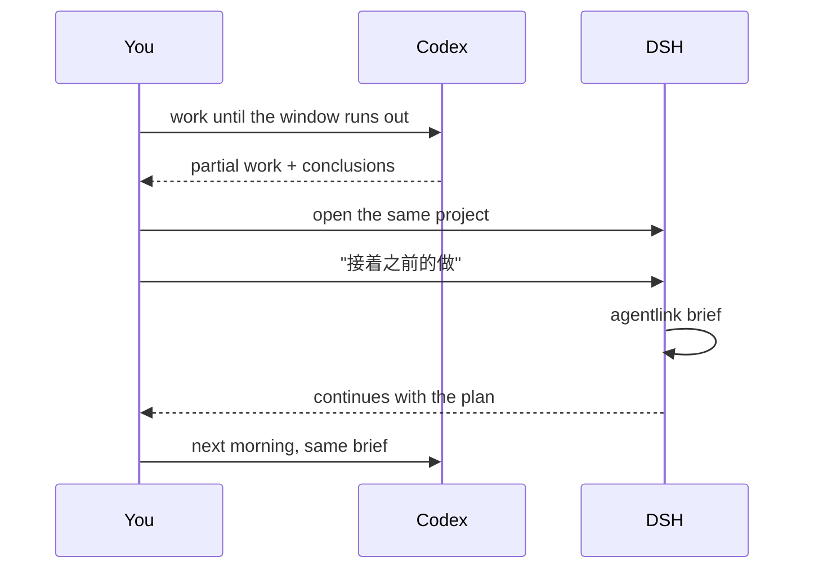
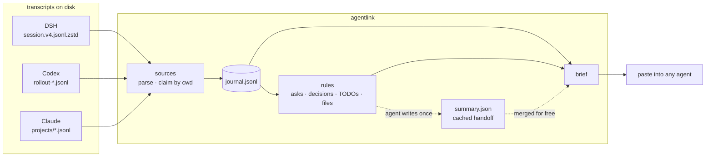

# agentlink

**Switch agents. Keep the plot.** One project, three tools — DSH, Codex (ChatGPT), Claude Code.

[](https://github.com/gougougouz/agent-context-bridge/actions/workflows/ci.yml)
[](https://www.python.org/)
[](LICENSE)

English · [简体中文](README.zh-CN.md) · [Install for agents](INSTALL.md)

---

You finish a Codex session, hit the usage ceiling, and open DSH to keep going. The first
thing it asks is what you are working on. So you explain the project again. Then why you
picked CSV over XLSX. Then you go looking for the file you had open two minutes ago.

All three tools keep transcripts — different directories, different formats, no awareness of
each other. `agentlink` reads them from disk, keeps what belongs to the current project, and
prints one brief you hand to whichever agent you are talking to now. The next agent starts
from the plan, not from zero.

```console
$ agentlink brief

# Project context · payments-service
> 4 sessions / 812 records (DSH, Codex, Claude; 2 days ago → 12 min ago)

## 1. Handoff summary (written by an agent)
- Goal: move settlement off cron batches onto event-driven consumers
- Status: core path migrated, rollback switch not built yet
- In progress: idempotency key write path. Next: reconciliation job, rollback flag

## 2. Current asks (newest first)
- 12 min ago (Codex): don't touch reconciliation yet, get idempotency passing first

## 3. Session cards
### Codex · idempotency keys (last active 12 min ago)
- Ask: composite key or uuid?
- Last conclusion: business_id+date, Redis lock on conflict
- Files: src/ledger/idempotency.py, migrations/007_idem.sql
- Commands: pytest tests/test_idempotency.py
```

## Install

One command. No git, no clone, no virtualenv.

```powershell
# Windows, PowerShell
irm https://raw.githubusercontent.com/gougougouz/agent-context-bridge/main/install.ps1 | iex
```

```bash
# macOS / Linux
curl -fsSL https://raw.githubusercontent.com/gougougouz/agent-context-bridge/main/install.sh | bash
```

Restart DSH / Codex / Claude, or open a new session, so they pick up the new skill.

### Or let your agent do it

Paste this into the chat box of any agent that can run shell commands, together with the
repository link:

> Install this skill for me: https://github.com/gougougouz/agent-context-bridge — follow
> `INSTALL.md`, then tell me where it landed.

The agent reads [INSTALL.md](INSTALL.md), checks Python, runs the one-liner for your OS,
verifies with `agentlink --version` and `agentlink doctor`, and reports the three skill paths.
That file is written for exactly this job, including what to do when the network, the home
directory or PATH is restricted. It needs no follow-up instructions.

| What it creates | Where |
| --- | --- |
| code | `%LOCALAPPDATA%\agentlink` (Windows) · `~/.local/share/agentlink` |
| skill, DSH | `~/.dsh/skills/agent-context-bridge/` |
| skill, Codex | `~/.codex/skills/agent-context-bridge/` |
| skill, Claude | `~/.claude/skills/agent-context-bridge/` |
| launcher | `<install dir>/bin/agentlink` |

Move it elsewhere with `-Dir D:\app\agentlink` (Windows) or
`AGENTLINK_HOME=/opt/agentlink` (macOS/Linux). Re-run the same command to upgrade.
[INSTALL.md](INSTALL.md) also covers uninstalling and every switch.

## Where do I type this?

Two different places, and it is worth knowing which is which.

**In a terminal** — PowerShell, Windows Terminal, iTerm, any shell. You type `agentlink`
there, inside the project directory:

```console
$ cd ~/code/payments-service
$ agentlink brief
```

This is for the first setup, for checking what was found, and for copying the brief into
somewhere else. Most people run it once per switch, or stop typing it entirely once the habit
is in place.

**In the agent's chat box** — you never type `agentlink` there. You say what you want in
normal language, and the agent runs the command itself:

| You say in the chat box | What happens |
| --- | --- |
| "接着之前的做" · "where were we?" | the agent runs `agentlink brief`, reads it, continues |
| "我刚从 Codex 切过来" · "I switched from Codex" | same, with the current ask emphasised |
| "把这一轮交接写下来" | the agent writes the summary and stores it for the next tool |
| "记一下：只做 CSV" | `agentlink note "只做 CSV" --kind decision` |
| "帮我装一下这个 skill：<仓库链接>" | the agent follows `INSTALL.md` and installs it |

The skill ships a `SKILL.md` description, so the agent reaches for it when the topic comes up
— you do not have to remember the command. If you prefer to be explicit, "run agentlink brief
and continue from it" works just as well.

## Quick start

```console
$ cd ~/code/payments-service
$ agentlink init

Initialised state dir: ~/code/payments-service/.agentlink
  - DSH: 1 session, 137 records
  - Codex (ChatGPT): 8 sessions, 2182 records
Total: 9 sessions, 2319 records

Next: run `agentlink brief`, and `agentlink hook` if you want new sessions to notice it.
```

Then, in the chat box: *"接着之前的做"*. Or in the terminal, `agentlink brief --copy` and
paste it.

`agentlink hook` is optional: it writes a short pointer into `AGENTS.md` / `CLAUDE.md` so a
new session notices the brief on its own. `init --hook` does both steps at once.



## What it reads, and what it writes



Two layers, on purpose. **Facts are cheap**: git state, recent asks, decisions and TODOs
pulled out by keyword, files and commands touched — deterministic, offline, instant. **Meaning
is expensive, so it is cached**: when a handoff deserves care, an agent reads the facts and
writes a structured summary once; every later brief merges it, in all three tools, for free.

Nothing leaves the machine. No API key, no telemetry. The only network request in the project
is the installer fetching the repository.

## Usage

**Quota ran out mid-task.** Say "接着之前的做" in the new tool, or run `agentlink brief`.
The agent gets the current ask, the last conclusion, the files involved and the open items.
When the hand-off is subtle, the agent writes the cached summary once and the next switch
reuses it.

**A task that spans days.** `agentlink brief --since 3d` keeps the brief focused; `--full`
adds the timeline, decisions and replay when you want the whole story. `agentlink status`
says whether the cached summary is still fresh.

**Not sure what happened yesterday.** `agentlink show --since yesterday --role user` lists
what you asked for; `agentlink show --session 4f2a` prints one session whole.

**A decision you do not want to lose.**
`agentlink note "只做 CSV，xlsx 下个迭代" --kind decision`. It shows up under decisions in
every tool from then on, which is more reliable than hoping it was written down in prose.

**A teammate needs the same context.** `.agentlink/` is git-ignored, so nothing is committed.
They run `agentlink brief` in the same repository and get the facts from their own
transcripts, plus the summary from the shared history.

## Commands

| Command | What it does |
| --- | --- |
| `agentlink init [--hook]` | create `.agentlink/`, pull existing sessions, optionally write the `AGENTS.md` pointer |
| `agentlink sync` | pull new records (implicit in most other commands) |
| `agentlink brief` | print the brief: `--full`, `--budget-tokens N`, `--since 3d`, `--out FILE`, `--copy`, `--stats`, `--no-ai`, `--no-git` |
| `agentlink digest` | compact material for an agent to summarise (`--full`, `--max-tokens`, `--out`) |
| `agentlink summary apply -f x.json` | store a handoff summary (`show`, `clear`) |
| `agentlink note "..." --kind todo` | record a judgement every tool will see (`note`, `decision`, `done`) |
| `agentlink status` | sources, counts, summary freshness, brief size |
| `agentlink show` | raw records: `--session ID`, `--role user`, `--since 3d`, `--limit N`, `--full` |
| `agentlink handoff --to claude` | write `.agentlink/HANDOFF.md` for one tool |
| `agentlink hook [--remove]` | maintain the pointer block in `AGENTS.md` / `CLAUDE.md` |
| `agentlink doctor` | dependencies, transcript directories, skill installs |
| `agentlink install [--path]` | (re)install the skill into the three directories |

Global flags: `--root DIR`, `--agent dsh,codex,claude`, `--lang en|zh`.

## What it costs

A default brief is about 2–3k tokens — a short README's worth — and it is the only thing that
enters a context window. That is usually the entire cost of switching tools.

| Tier | Command | Roughly | Use it when |
| --- | --- | --- | --- |
| L0 | `agentlink status` | 50 tokens | checking whether there is anything to sync |
| **L1** | `agentlink brief` | **~3k** | default: switching tools, "where were we" |
| L2 | `agentlink brief --full` | ~8k | you want the timeline, decisions and replay |
| L3 | `agentlink digest` → JSON → `summary apply` | 3–8k, **once** | long hand-off, multi-day work |

L3 is what keeps this affordable without cutting corners: `digest` hands the agent the
previous summary plus only the records added since, so a refresh costs a fraction of a
re-read. Refresh when `brief --stats` says it is behind, or when the work genuinely moved on
— not on every switch.

## Project state

```
your-project/
├── .agentlink/              # git-ignored, disposable
│   ├── config.json          # agents, extra roots, token budgets, git toggle
│   ├── state.json           # per-file cursors, session titles, seen records
│   ├── journal.jsonl        # normalised events (rebuildable)
│   ├── notes.jsonl          # your `agentlink note` entries
│   ├── context.md           # last brief
│   ├── summary.json         # cached handoff, shared by all three tools
│   └── HANDOFF.md           # `agentlink handoff` output
├── AGENTS.md                # optional pointer, written by `agentlink hook`
└── CLAUDE.md                # same
```

Delete `.agentlink/` and the next `brief` rebuilds everything from the transcripts. Set
`AGENTLINK_STATE_DIR` to keep state outside the repository, for a project on a slow or
read-only mount.

## Writing a handoff summary

`agentlink digest` prints material shaped like this (trimmed):

```json
{
  "mode": "incremental",
  "previous_summary": { "project": {}, "state": {}, "sessions": [] },
  "new_events": [
    { "agent": "codex", "role": "user", "ts": "...", "text": "对账任务先别动" }
  ],
  "schema_hint": { "version": 1, "fields": ["project.goal", "state.in_progress[]", "..."] }
}
```

Write it back as:

```json
{
  "version": 1,
  "project": { "goal": "one sentence", "status": "where it stands", "stack": "..." },
  "state": {
    "done": [], "in_progress": [], "blocked": [],
    "decisions": [], "next": [], "risks": []
  },
  "sessions": [
    { "agent": "codex", "id": "...", "title": "...",
      "one_line": "...", "outcome": "...", "open": [] }
  ],
  "notes_for_next_agent": []
}
```

Rules the skill gives the writing agent: only claim what the material supports; one line per
item, under 60 characters; conclusions rather than transcripts; anything uncertain goes into
`blocked` or `risks`. `summary apply` is tolerant — missing fields are ignored, a bare string
becomes a one-item list — but it refuses a document with nothing usable in it rather than
overwriting a good summary with an empty one.

## Troubleshooting

| Symptom | Cause and fix |
| --- | --- |
| `agentlink: command not found` | the PATH entry takes effect in new terminals only; or use the launcher inside the skill folder (its `LOCAL.md` has the absolute path) |
| a tool reports `0 sessions` | the project's working directory differs from what the transcript recorded — run once with `--root <old path>` |
| the project was moved or renamed | add the old absolute path to `roots` in `.agentlink/config.json`; the transcripts recorded there come back |
| `zstandard is not installed` | only DSH needs it: `python -m pip install zstandard` |
| brief looks empty | records are older than `--since`, or belong to another path; `agentlink status` shows what was found |
| summary marked stale | more than a handful of new records arrived; rerun the L3 loop, or ignore it — the rules layer is still current |
| the agent does not seem to know the skill | restart the client or open a new session; `agentlink doctor` shows whether `SKILL.md` is in place |
| the install one-liner fails with a parse error right after an update | your mirror is serving a stale copy; retry in a minute, or use https://cdn.jsdelivr.net/gh/gougougouz/agent-context-bridge@main/install.ps1 |

## Design notes

- **No model in the default path.** Something you run on every switch cannot cost money.
  Facts have to be free and instant; meaning can be paid for once.
- **A JSON schema instead of prose.** Prose summaries drift and duplicate; a fixed schema
  merges, diffs and renders predictably, and it is cheap to validate.
- **State inside the project.** The unit of context is the project, so the state travels with
  it — through backups, not through git. Ignored by default.
- **Per-project, not global.** Two projects interleaved produce a brief that is technically
  true and practically useless.
- **Read-only on transcripts.** Nothing in `~/.dsh`, `~/.codex` or `~/.claude` is modified.

## Limits

- The rules layer reads text, not meaning. A decision nobody wrote down can slip through —
  that is what `agentlink note` is for.
- Transcript formats are each vendor's internal business. Unknown record types are skipped
  rather than fatal, but a breaking change upstream may hide data until the parser catches up.
- The same repository at two paths counts as two projects.
- Token counts are estimates (display width ÷ 1.8): good for budgeting, not for billing.

## Development

```bash
python -m unittest discover -s tests -v     # 15 offline tests, temp fixtures only
PYTHONPATH=src python -m agentlink doctor
```

The checkout is self-contained, so it can sit next to other skills — this copy lives in
`F:\development\skills\agent-context-bridge`. CI runs the suite on Ubuntu and Windows, Python
3.9 and 3.12. Tests never touch real transcripts: each writes synthetic sessions into a temporary home directory, including a
deliberately corrupt line to prove reads survive it.

```
src/agentlink/
├── cli.py        commands, argument handling, error messages
├── store.py      .agentlink state, cursors, journal, notes
├── sources/
│   ├── base.py   discovery, incremental reader, tool summaries
│   ├── dsh.py    zstd frames, seq cursors, noise filters
│   ├── codex.py  rollout JSONL, control-tag stripping, session titles
│   └── claude.py content blocks, tool_use, sidechain skipping
├── digest.py     brief builder: sections, budgets, timelines, token estimate
├── summary.py    cached handoff: schema, validation, rendering
├── activity.py   files and commands touched
├── i18n.py       zh / en strings
├── gitinfo.py    git snapshot
└── install.py    skill installation, launcher, AGENTS.md pointer
```

A fourth agent means one file under `sources/` (`discover` and `ingest`) plus an entry in
`SOURCES`; the brief builder does not care where events came from.

MIT © Junwen Zhao