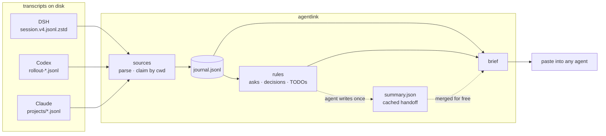

# agentlink

**Switch agents. Keep the plot.** One project, three tools — DSH, Codex (ChatGPT), Claude Code.

[](https://github.com/gougougouz/agent-context-bridge/actions/workflows/ci.yml)
[](https://www.python.org/)
[](LICENSE)

English · [简体中文](README.zh-CN.md) · [Install for agents](INSTALL.md) · [How it works](docs/internals.md)

---

Codex runs out of window mid-task. You open DSH, and it asks what you are working on — so you
explain the project again, then the decision from an hour ago, then go looking for the file you
had open two minutes ago.

The three tools already keep transcripts. They just never read each other's. `agentlink` reads
them from disk, keeps the part that belongs to this project, and prints one brief for whichever
agent you are using now.

```console
$ agentlink brief

# Project context · payments-service
> 4 sessions / 812 records (DSH, Codex, Claude; 2 days ago → 12 min ago)

## Handoff summary
- Goal: move settlement off cron batches onto event-driven consumers
- Status: core path migrated; rollback switch not built
- Next: reconciliation job, rollback flag

## Current asks
- 12 min ago (Codex): don't touch reconciliation yet, get idempotency passing first

## Session cards
### Codex · idempotency keys
- Conclusion: business_id+date as the key, Redis lock on conflict
- Files: src/ledger/idempotency.py, migrations/007_idem.sql
```

At a glance:

- reads `~/.dsh`, `~/.codex` and `~/.claude` — never writes to them
- no daemon, no account, no key, nothing uploaded
- ~3k tokens per switch; a cached summary sharpens later switches for free

## Install

One command.

```powershell
# Windows, PowerShell
irm https://raw.githubusercontent.com/gougougouz/agent-context-bridge/main/install.ps1 | iex
```

```bash
# macOS / Linux
curl -fsSL https://raw.githubusercontent.com/gougougouz/agent-context-bridge/main/install.sh | bash
```

Restart the tools (or open a new session) so they pick up the skill.

**Or hand it to an agent.** Paste this into any agent that can run commands, with the link:

> Install this skill for me: https://github.com/gougougouz/agent-context-bridge — follow
> `INSTALL.md`, then tell me where it landed.

[INSTALL.md](INSTALL.md) is written for that job: Python check, per-OS command,
verification, and what to do when the network or PATH is restricted.

| What it creates | Where |
| --- | --- |
| code | `%LOCALAPPDATA%\agentlink` (Windows) · `~/.local/share/agentlink` |
| skills | `~/.dsh/skills/`, `~/.codex/skills/`, `~/.claude/skills/` |
| launcher | `<install dir>/bin/agentlink` |

Re-run the same command to upgrade. `-Dir D:\app\agentlink` (or `AGENTLINK_HOME=`) puts it
somewhere else; [INSTALL.md](INSTALL.md) has the switches and the uninstall steps.

## Use it

| Where | What you do |
| --- | --- |
| **In the chat box** | say "接着之前的做" / "where were we?" — the agent runs `agentlink brief` and continues |
| **In Codex, explicitly** | type `$`, pick **agent-context-bridge**; or write "use agent-context-bridge..." |
| **In a terminal** | `cd project && agentlink brief` (add `--copy` to put it on the clipboard) |

The skill carries its own description, so the agent reaches for it when the conversation
turns to switching tools or lost context.

First time in a project:

```console
$ agentlink init
Initialised state dir: ~/code/payments-service/.agentlink
  - DSH: 1 session, 137 records
  - Codex (ChatGPT): 8 sessions, 2182 records
Total: 9 sessions, 2319 records
```

`agentlink init --hook` also writes a pointer into `AGENTS.md` / `CLAUDE.md`, so a new
session reads the brief on its own.

## What is in the brief

- **Handoff summary** — an agent reads the facts once and writes this; every later brief merges
  it, in all three tools, without paying again.
- **Current asks** — your last few requests, newest first, close to verbatim.
- **Session cards** — per session: what it was for, the last conclusion, files and commands.
- **Timeline** — merged by timestamp, so a Codex → DSH → Claude relay reads as one story.
- **TODOs and decisions** — extracted by keyword in Chinese and English, plus anything you
  added with `agentlink note`.



## What it costs

| Tier | Command | Roughly | When |
| --- | --- | --- | --- |
| L0 | `agentlink status` | 50 tokens | is there anything new? |
| **L1** | `agentlink brief` | **~3k** | default: switching tools |
| L2 | `agentlink brief --full` | ~8k | you want timeline, decisions and replay |
| L3 | `digest` → JSON → `summary apply` | 3–8k, once | long hand-off, multi-day work |

`digest` passes the agent the previous summary plus only what is new, so a refresh costs a
fraction of a re-read — worth doing when `brief --stats` says the summary is behind, not on
every switch. Schema and validation: [docs/summary-schema.md](docs/summary-schema.md).

## Commands

**Setup**

| Command | |
| --- | --- |
| `agentlink init [--hook]` | create `.agentlink/`, pull existing sessions, optional pointer |
| `agentlink install [--path]` | reinstall the skill into the three directories |
| `agentlink doctor` | dependencies, transcript directories, installed skills |

**Daily**

| Command | |
| --- | --- |
| `agentlink brief` | the brief: `--full`, `--since 3d`, `--copy`, `--out FILE`, `--budget-tokens N`, `--no-ai`, `--no-git`, `--stats` |
| `agentlink note "..." --kind decision` | record a judgement all three tools will see (`note`, `decision`, `done`) |
| `agentlink status` | sources, counts, summary freshness, brief size |
| `agentlink sync` | pull new records only |

**Looking closer**

| Command | |
| --- | --- |
| `agentlink show` | raw records: `--session ID`, `--role user`, `--since 3d`, `--limit N`, `--full` |
| `agentlink digest` | material for an agent to summarise (`--full`, `--max-tokens`, `--out`) |
| `agentlink summary show\|apply\|clear` | inspect, store or drop the cached summary |
| `agentlink handoff --to claude` | write `.agentlink/HANDOFF.md` for one tool |
| `agentlink hook [--remove]` | maintain the `AGENTS.md` / `CLAUDE.md` pointer |

Global flags: `--root DIR`, `--agent dsh,codex,claude`, `--lang en|zh`.

## When something looks wrong

| Symptom | Cause and fix |
| --- | --- |
| `agentlink: command not found` | PATH changes apply to new terminals; or run the launcher in the skill folder (`LOCAL.md` has its absolute path) |
| a tool reports `0 sessions` | the project's recorded `cwd` differs from where you are now — run once with `--root <old path>` |
| the project was moved or renamed | add the old path to `roots` in `.agentlink/config.json` |
| `zstandard is not installed` | only DSH needs it: `python -m pip install zstandard` |
| the brief looks empty | records are older than `--since` or belong to another path; `agentlink status` shows what was found |
| the agent does not know the skill | restart the client or open a new session; `agentlink doctor` lists what is installed |
| the install one-liner fails right after an update | your mirror is serving a stale copy; retry in a minute, or use `https://cdn.jsdelivr.net/gh/gougougouz/agent-context-bridge@main/install.ps1` |

## Boundaries

- **Private by construction.** Transcripts are read-only; no network after install, no
  telemetry, no key. State sits in `.agentlink/`, git-ignored and disposable.
- **Text, not meaning.** The rules layer cannot infer a decision nobody wrote down; that is
  what `agentlink note` is for.
- **Formats belong to the vendors.** Unknown record types are skipped rather than fatal, but an
  upstream format change can hide data until the parser catches up.
- **One path, one project.** The same repository at two paths counts twice unless you add the
  old path to `roots`.
- Token counts are estimates (display width ÷ 1.8): fine for budgeting, not for billing.

## Development

```bash
python -m unittest discover -s tests -v     # 20 offline tests, temp fixtures only
PYTHONPATH=src python -m agentlink doctor
```

CI runs the suite on Ubuntu and Windows, Python 3.9 and 3.12. Tests never touch real
transcripts: each writes synthetic sessions into a temporary home directory, including a
corrupt line to prove reads survive it.

Parsing rules, state layout and how to add a fourth agent:
[docs/internals.md](docs/internals.md).

MIT © Junwen Zhao