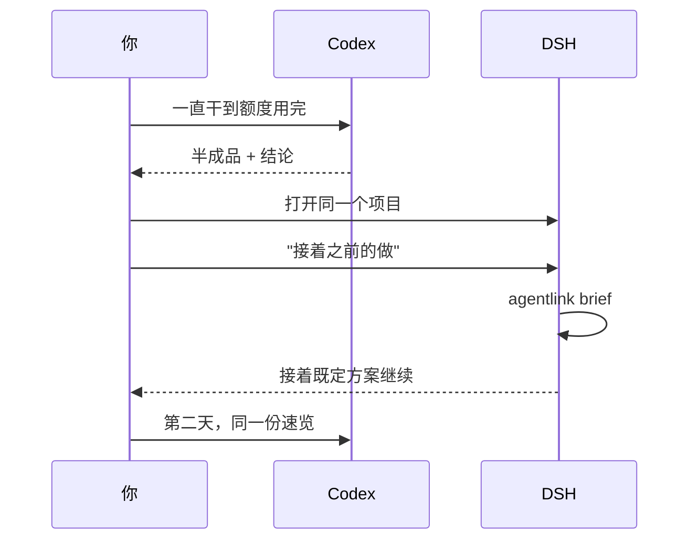
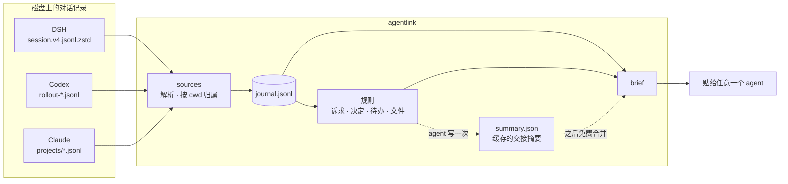

# agentlink

**换工具，不换思路。** 一个项目，三个工具 —— DSH、Codex（ChatGPT）、Claude Code。

[](https://github.com/gougougouz/agent-context-bridge/actions/workflows/ci.yml)
[](https://www.python.org/)
[](LICENSE)

[English](README.md) · 简体中文 · [给 agent 看的安装说明](INSTALL.md)

---

Codex 的额度用完了，你打开 DSH 接着干。它问你想做什么。于是你又讲了一遍项目，
又讲了一遍当时为什么选 CSV 而不是 XLSX，然后回头去找两分钟前还开着的那个文件。

三家工具都存对话，只是位置不同、格式不同，彼此也不认识对方。`agentlink` 把这些记录
从磁盘读出来，只留当前项目的部分，合成一份速览 —— 交给现在正在用的那个 agent。
下一个 agent 拿到的是计划，不是空白。

```console
$ agentlink brief

# 项目上下文速览 · payments-service
> 4 个会话 / 812 条记录（DSH、Codex、Claude；2 天前 → 12 分钟前）

## 1. 接手摘要（AI 整理）
- 项目目标：把结算服务从定时批处理迁到事件驱动
- 当前状态：核心链路已迁移，回滚开关还没做
- 正在做：幂等键落库。下一步：对账任务、回滚开关

## 2. 当前任务（最近的用户请求，新→旧）
- **12 分钟前**（Codex）：对账任务先别动，先把幂等跑通

## 3. 各会话卡片
### Codex · 幂等键设计（最后活动 12 分钟前）
- **诉求**：唯一键用 business_id+date 还是 uuid？
- **最后结论**：定 business_id+date，冲突时用 Redis 锁兜底
- **涉及文件**：src/ledger/idempotency.py、migrations/007_idem.sql
- **关键命令**：pytest tests/test_idempotency.py
```

## 安装

一条命令。不需要 git，不需要 clone，不需要虚拟环境。

```powershell
# Windows，PowerShell
irm https://raw.githubusercontent.com/gougougouz/agent-context-bridge/main/install.ps1 | iex
```

```bash
# macOS / Linux
curl -fsSL https://raw.githubusercontent.com/gougougouz/agent-context-bridge/main/install.sh | bash
```

装完重启 DSH / Codex / Claude，或者新开一个会话，让它们认出这个技能。

### 或者让 agent 来装

把下面这段连同仓库链接发给任何一个能执行命令的 agent：

> 帮我装一下这个 skill：https://github.com/gougougouz/agent-context-bridge
> 按 `INSTALL.md` 来，装完告诉我装到哪了。

它会读 [INSTALL.md](INSTALL.md)、检查 Python、按系统执行对应的一条命令，再用
`agentlink --version` 和 `agentlink doctor` 验证，最后把三个技能路径告诉你。
那份文件就是为这个场景写的，网络受限、家目录只读、PATH 不能改的情况都写进去了，
不需要你再补充说明。

| 装了什么 | 在哪 |
| --- | --- |
| 代码 | Windows `%LOCALAPPDATA%\agentlink`；macOS/Linux `~/.local/share/agentlink` |
| DSH 技能 | `~/.dsh/skills/agent-context-bridge/` |
| Codex 技能 | `~/.codex/skills/agent-context-bridge/` |
| Claude 技能 | `~/.claude/skills/agent-context-bridge/` |
| 启动器 | `<安装目录>/bin/agentlink` |

想换个盘：Windows 加 `-Dir D:\app\agentlink`，macOS/Linux 用
`AGENTLINK_HOME=/opt/agentlink`。升级就是再跑一次同样的命令。
卸载方式和各个开关都在 [INSTALL.md](INSTALL.md)。

## 命令到底在哪儿输入

两个地方，分清楚就顺了。

**终端里** —— PowerShell、Windows Terminal、iTerm，随便哪个 shell。在项目目录下敲
`agentlink`：

```console
$ cd ~/code/payments-service
$ agentlink brief
```

第一次配置、想看它到底读到了什么、想把这坨文本复制走，都在这里做。
顺手之后大多数人只在切换时敲一次，甚至完全不敲。

**agent 的聊天框里** —— 那里从来不用敲 `agentlink`。你用日常语言说需求，agent 自己执行：

| 在聊天框里说 | 实际发生什么 |
| --- | --- |
| "接着之前的做" · "刚才聊到哪了" | agent 跑 `agentlink brief`，读完继续干活 |
| "我刚从 Codex 切过来" | 同上，并且会更关注当前那条诉求 |
| "把这一轮交接写下来" | agent 写结构化摘要并存起来，下一个工具直接用 |
| "记一下：只做 CSV" | `agentlink note "只做 CSV" --kind decision` |
| "帮我装一下这个 skill：<仓库链接>" | agent 按 `INSTALL.md` 装好并汇报 |

在 Codex 里还有第三种方式：输入 `$`，候选里选 **agent-context-bridge**。
这是显式点名，即使模型没想起来，技能也会被执行。直接写在句子里同样有效：
"用 agent-context-bridge 看看我们之前做到哪了"。

技能自带 `SKILL.md` 描述，聊到相关话题时 agent 会自己想起来用它 —— 命令不用背。
想明确一点也行："跑一下 agentlink brief，然后接着做"。

## 头五分钟

```console
$ cd ~/code/payments-service
$ agentlink init

已初始化状态目录：~/code/payments-service/.agentlink
  - DSH：1 个会话，137 条记录
  - Codex / ChatGPT：8 个会话，2182 条记录
合计 9 个会话、2319 条记录

下一步：`agentlink brief` 看一眼项目上下文，愿意的话再 `agentlink hook`。
```

然后在聊天框里说一句 *"接着之前的做"*；或者在终端 `agentlink brief --copy` 直接进剪贴板。

`agentlink hook` 是可选的：往 `AGENTS.md` / `CLAUDE.md` 里写一小段提示，让新会话自己
想起来读速览。`init --hook` 把初始化和这一步合成一次。



## 它读什么，写什么



两层，故意分开。**事实要便宜**：git 状态、最近的诉求、按关键词抓出来的决定和待办、
碰过的文件与命令 —— 确定性、离线、即时。**结论很贵，所以缓存**：真需要认真交接时，
让 agent 读一遍事实、写一份结构化摘要；之后每次 brief 免费合并，三家共用。

不联网、不上传、不需要 API key。整个项目唯一会联网的地方，是安装脚本下载仓库。

## 使用场景

**额度用完、任务做到一半。** 在新工具里说一句"接着之前的做"，或者跑 `agentlink brief`。
新 agent 拿到当前诉求、最后结论、涉及的文件和没做完的事。交接比较微妙时，
它顺手写一次缓存摘要，下次切换直接复用。

**一个任务做好几天。** `agentlink brief --since 3d` 让速览只看这三天；想连时间线、
决定和回放一起看就 `--full`。`agentlink status` 会告诉你缓存摘要还新不新鲜。

**忘了昨天干了什么。** `agentlink show --since yesterday --role user` 列出当时的请求；
`agentlink show --session 4f2a` 完整看一个会话。

**有个决定不能弄丢。** `agentlink note "只做 CSV，xlsx 下个迭代" --kind decision`。
从这以后三个工具都会在"决定"里看到它，比指望谁在正文里写上更可靠。

**同事要接手。** `.agentlink/` 被 git 忽略，不会被提交。他在同一个仓库里跑一次
`agentlink brief`：事实来自他本机的记录，结论来自仓库里共同的历史。

## 命令

| 命令 | 作用 |
| --- | --- |
| `agentlink init [--hook]` | 建 `.agentlink/`、抽取已有会话，可选写入 `AGENTS.md` 提示段 |
| `agentlink sync` | 只抽取新记录（多数命令会隐式做） |
| `agentlink brief` | 打印速览：`--full`、`--budget-tokens N`、`--since 3d`、`--out FILE`、`--copy`、`--stats`、`--no-ai`、`--no-git` |
| `agentlink digest` | 给 agent 做摘要的紧凑材料（`--full`、`--max-tokens`、`--out`） |
| `agentlink summary apply -f x.json` | 保存交接摘要（`show` 查看、`clear` 清除） |
| `agentlink note "..." --kind todo` | 写一条判断，三家都能看到（`note`/`decision`/`done`） |
| `agentlink status` | 数据源、数量、摘要新鲜度、速览大小 |
| `agentlink show` | 原始记录：`--session ID`、`--role user`、`--since 3d`、`--limit N`、`--full` |
| `agentlink handoff --to claude` | 生成 `.agentlink/HANDOFF.md` 给指定工具 |
| `agentlink hook [--remove]` | 维护 `AGENTS.md` / `CLAUDE.md` 里的提示段 |
| `agentlink doctor` | 依赖、会话目录、技能安装状态自检 |
| `agentlink install [--path]` | （重新）把技能装进三个目录 |

通用参数：`--root DIR`、`--agent dsh,codex,claude`、`--lang en|zh`。

## 花多少 token

默认一份速览约 2–3k tokens，相当于一个短 README，也是切换工具时唯一进入上下文的东西。

| 档位 | 命令 | 大致 | 什么时候用 |
| --- | --- | --- | --- |
| L0 | `agentlink status` | 50 tokens | 先确认有没有东西可同步 |
| **L1** | `agentlink brief` | **~3k** | 默认：换工具、问进度 |
| L2 | `agentlink brief --full` | ~8k | 连时间线、决定和回放一起看 |
| L3 | `agentlink digest` → JSON → `summary apply` | 3–8k，**只花一次** | 长任务交接、跨天工作 |

L3 是"既省又准"的关键：`digest` 交出去的是上一版摘要加上之后新增的记录，所以刷新只需要
重读一小部分。什么时候刷新？`brief --stats` 说它落后了，或者工作确实推进了 —— 不是每次
切换都刷。

## 项目状态目录

```
your-project/
├── .agentlink/              # 被 git 忽略，随时可删
│   ├── config.json          # agent 列表、旧路径、token 预算、git 开关
│   ├── state.json           # 文件游标、会话标题、已见记录
│   ├── journal.jsonl        # 归一化记录（可重建）
│   ├── notes.jsonl          # `agentlink note` 写的内容
│   ├── context.md           # 上次生成的速览
│   ├── summary.json         # 缓存的交接摘要，三家共用
│   └── HANDOFF.md           # `agentlink handoff` 的产物
├── AGENTS.md                # 可选，`agentlink hook` 写入的提示段
└── CLAUDE.md                # 同上
```

删掉 `.agentlink/`，下次 `brief` 会从会话记录重建。不想把状态放在仓库里，设置
`AGENTLINK_STATE_DIR`（项目在慢盘或只读挂载上时有用）。

## 怎么写一份交接摘要

`agentlink digest` 给出的材料大致是这样（已省略）：

```json
{
  "mode": "incremental",
  "previous_summary": { "project": {}, "state": {}, "sessions": [] },
  "new_events": [
    { "agent": "codex", "role": "user", "ts": "...", "text": "对账任务先别动" }
  ],
  "schema_hint": { "version": 1, "fields": ["project.goal", "state.in_progress[]", "..."] }
}
```

写成这样交回去：

```json
{
  "version": 1,
  "project": { "goal": "一句话目标", "status": "当前阶段", "stack": "技术栈" },
  "state": {
    "done": [], "in_progress": [], "blocked": [],
    "decisions": [], "next": [], "risks": []
  },
  "sessions": [
    { "agent": "codex", "id": "...", "title": "...",
      "one_line": "...", "outcome": "...", "open": [] }
  ],
  "notes_for_next_agent": []
}
```

技能给撰写 agent 的纪律：只写材料能证实的；每条一行、60 字以内；写结论而不是抄原文；
拿不准的放进 `blocked` 或 `risks`。`summary apply` 是宽容的 —— 缺字段忽略、字符串自动
收成单元素列表 —— 但一份空文档会被拒绝，而不是覆盖掉之前那份好的。

## 出问题时

| 现象 | 原因与处理 |
| --- | --- |
| 找不到 `agentlink` | 安装脚本加的 PATH 只在新终端生效；或直接用技能目录里的启动器（`LOCAL.md` 有绝对路径） |
| 某一家显示 `0 个会话` | 那个项目在该工具里的工作目录和记录不一致，用 `--root <当时的路径>` 跑一次 |
| 项目挪了位置或改了名 | 把旧路径加进 `.agentlink/config.json` 的 `roots`，那边的历史就会回来 |
| 提示 `zstandard is not installed` | 只有 DSH 需要：`python -m pip install zstandard` |
| 速览是空的 | 记录比 `--since` 更早，或者属于别的路径；`agentlink status` 会说明找到了什么 |
| 摘要被标成"落后" | 新增记录超过阈值；重新走一次 L3，或者直接忽略 —— 规则层仍然是最新的 |
| agent 好像不认识这个技能 | 重启客户端或新开会话；`agentlink doctor` 会显示 `SKILL.md` 有没有就位 |
| 刚升级完，一行安装命令报语法错 | 镜像还在给旧文件；等一分钟重试，或用 https://cdn.jsdelivr.net/gh/gougougouz/agent-context-bridge@main/install.ps1 |

## 几个刻意的取舍

- **默认路径不调模型。** 每次切换都要跑的东西不能花钱：事实必须免费且即时，
  结论可以花一次钱换质量。
- **用 JSON 而不是自由文本。** 散文式摘要会漂移、会重复；固定结构才能稳定合并、
  对比和渲染，也容易校验。
- **状态放在项目里。** 上下文的单位是项目，状态就应该跟着项目走（靠备份，不靠 git）。
- **按项目而不是全局。** 两个项目混在一起，会得到一份"技术上正确、实际上没用"的速览。
- **对原始记录只读。** `~/.dsh`、`~/.codex`、`~/.claude` 里的东西一个字节都不改。

## 边界

- 规则层读的是文字，不是语义。没人写下来的决定可能漏掉 —— 这正是 `agentlink note` 的用处。
- 三家会话格式都是各自的内部实现。不认识的记录会跳过而不是崩溃，但上游真改了格式，
  可能暂时读不到新数据。
- 同一个仓库放在两个路径，会被当成两个项目。
- token 数是估算（显示宽度 ÷ 1.8），用来做预算足够，别拿它记账。

## 开发

```bash
python -m unittest discover -s tests -v     # 15 个离线测试，只用临时假数据
PYTHONPATH=src python -m agentlink doctor
```

仓库是自包含的，可以和别的技能并排放 —— 现在这份在 `F:\development\skills\agent-context-bridge`。
CI 在 Ubuntu 和 Windows 上跑 Python 3.9 与 3.12。测试不碰真实会话：每个用例把合成数据
写进临时 home 目录，其中一条故意写成坏行，用来证明读取不会因此中断。

```
src/agentlink/
├── cli.py        命令行入口、参数处理、报错信息
├── store.py      .agentlink 状态、游标、journal、notes
├── sources/
│   ├── base.py   共享的发现、增量读取、工具摘要
│   ├── dsh.py    zstd 多帧、seq 游标、噪声过滤
│   ├── codex.py  rollout JSONL、控制标签清理、会话标题
│   └── claude.py content 块、tool_use、跳过 sidechain
├── digest.py     速览生成：分节、预算、时间线、token 估算
├── summary.py    缓存摘要：格式、校验、渲染
├── activity.py   碰过的文件与命令
├── i18n.py       中英文案
├── gitinfo.py    git 快照
└── install.py    安装技能、生成启动器、写 AGENTS.md 提示段
```

想接第四家工具，只需要在 `sources/` 下加一个文件（`discover` 与 `ingest` 两个方法），
再在 `SOURCES` 里注册；速览生成那边不关心记录来自哪里。

MIT © Junwen Zhao