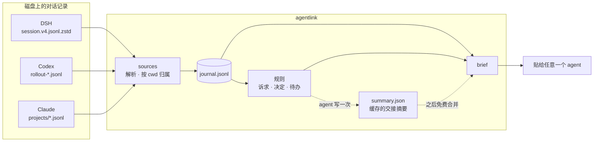

# agentlink

**换工具，不换思路。** 一个项目，三个工具 —— DSH、Codex（ChatGPT）、Claude Code。

[](https://github.com/gougougouz/agent-context-bridge/actions/workflows/ci.yml)
[](https://www.python.org/)
[](LICENSE)

[English](README.md) · 简体中文 · [给 agent 看的安装说明](INSTALL.md) · [实现细节](docs/internals.md)

---

Codex 的额度在半路用完。你打开 DSH，它问你想做什么 —— 于是你又讲了一遍项目、
又讲了一遍一小时前的那个决定，然后回头去找两分钟前还开着的文件。

三家工具本来就存着对话，只是谁也不读对方的。`agentlink` 把这些记录从磁盘读出来，
只留当前项目的部分，合成一份速览，交给现在正在用的那个 agent。

```console
$ agentlink brief

# 项目上下文速览 · payments-service
> 4 个会话 / 812 条记录（DSH、Codex、Claude；2 天前 → 12 分钟前）

## 接手摘要
- 项目目标：把结算服务从定时批处理迁到事件驱动
- 当前状态：核心链路已迁移，回滚开关还没做
- 下一步：对账任务、回滚开关

## 当前任务
- **12 分钟前**（Codex）：对账任务先别动，先把幂等跑通

## 各会话卡片
### Codex · 幂等键设计
- **最后结论**：唯一键定 business_id+date，冲突用 Redis 锁兜底
- **涉及文件**：src/ledger/idempotency.py、migrations/007_idem.sql
```

一句话概括：

- 读 `~/.dsh`、`~/.codex`、`~/.claude`，**从不写入**这些目录
- 没有常驻进程、不用账号、没有 key、不上传任何东西
- 每次切换约 3k tokens；缓存摘要让之后的切换更准，且不再花钱

## 安装

一条命令。

```powershell
# Windows，PowerShell
irm https://raw.githubusercontent.com/gougougouz/agent-context-bridge/main/install.ps1 | iex
```

```bash
# macOS / Linux
curl -fsSL https://raw.githubusercontent.com/gougougouz/agent-context-bridge/main/install.sh | bash
```

装完重启这些工具（或新开会话），让它们认出技能。

**也可以直接甩给 agent。** 把下面这段连同仓库链接发给任何一个能执行命令的 agent：

> 帮我装一下这个 skill：https://github.com/gougougouz/agent-context-bridge
> 按 `INSTALL.md` 来，装完告诉我装到哪了。

[INSTALL.md](INSTALL.md) 就是为这个场景写的：查 Python、按系统选命令、装完验证，
以及网络或 PATH 受限时怎么办。

| 装了什么 | 在哪 |
| --- | --- |
| 代码 | Windows `%LOCALAPPDATA%\agentlink`；macOS/Linux `~/.local/share/agentlink` |
| 技能 | `~/.dsh/skills/`、`~/.codex/skills/`、`~/.claude/skills/` |
| 启动器 | `<安装目录>/bin/agentlink` |

升级就是再跑一次同样的命令。想换地方：Windows 加 `-Dir D:\app\agentlink`，
macOS/Linux 用 `AGENTLINK_HOME=...`；各个开关和卸载步骤都在 [INSTALL.md](INSTALL.md)。

## 怎么用

| 在哪 | 做什么 |
| --- | --- |
| **聊天框里** | 说一句"接着之前的做" / "刚才聊到哪了" —— agent 自己跑 `agentlink brief` 然后继续 |
| **Codex 里显式点名** | 输入 `$`，选 **agent-context-bridge**；或者直接写"用 agent-context-bridge…" |
| **终端里** | `cd 项目 && agentlink brief`（加 `--copy` 直接进剪贴板） |

技能自带描述，聊到换工具、上下文断了的时候，agent 会自己想起来用。

第一次在一个项目里用：

```console
$ agentlink init
已初始化状态目录：~/code/payments-service/.agentlink
  - DSH：1 个会话，137 条记录
  - Codex / ChatGPT：8 个会话，2182 条记录
合计 9 个会话、2319 条记录
```

`agentlink init --hook` 会顺手往 `AGENTS.md` / `CLAUDE.md` 写一小段提示，
让新会话自己先读速览。

## 速览里有什么

- **接手摘要** —— agent 读一遍事实后写下的一份；之后每次 brief 都合并进来，三家共用，
  不再重复花钱。
- **当前任务** —— 你最近的几条请求，新的在前，近乎原话。
- **各会话卡片** —— 每个会话：为了什么、最后的结论、碰过哪些文件、跑过什么命令。
- **时间线** —— 按时间合并，所以「Codex → DSH → Claude」接力过的任务读起来是一件事。
- **待办与决定** —— 中英文关键词抽取，再加上你用 `agentlink note` 手动记的。



## 花多少 token

| 档位 | 命令 | 大致 | 什么时候用 |
| --- | --- | --- | --- |
| L0 | `agentlink status` | 50 tokens | 先看有没有新东西 |
| **L1** | `agentlink brief` | **~3k** | 默认：换工具 |
| L2 | `agentlink brief --full` | ~8k | 想连时间线、决定、回放一起看 |
| L3 | `digest` → JSON → `summary apply` | 3–8k，一次 | 长任务交接、跨天工作 |

`digest` 交给 agent 的是「上一版摘要 + 之后新增的记录」，刷新只重读一小部分 ——
`brief --stats` 说摘要落后了再刷，不用每次切换都刷。格式与校验：
[docs/summary-schema.md](docs/summary-schema.md)。

## 命令

**装和配**

| 命令 | |
| --- | --- |
| `agentlink init [--hook]` | 建 `.agentlink/`、抽取已有会话，可选写提示段 |
| `agentlink install [--path]` | 重新把技能装进三个目录 |
| `agentlink doctor` | 依赖、会话目录、已安装的技能 |

**日常**

| 命令 | |
| --- | --- |
| `agentlink brief` | 速览：`--full`、`--since 3d`、`--copy`、`--out FILE`、`--budget-tokens N`、`--no-ai`、`--no-git`、`--stats` |
| `agentlink note "..." --kind decision` | 记一条判断，三家都能看到（`note`/`decision`/`done`） |
| `agentlink status` | 数据源、数量、摘要新鲜度、速览大小 |
| `agentlink sync` | 只抽取新记录 |

**想看得更细**

| 命令 | |
| --- | --- |
| `agentlink show` | 原始记录：`--session ID`、`--role user`、`--since 3d`、`--limit N`、`--full` |
| `agentlink digest` | 给 agent 做摘要的材料（`--full`、`--max-tokens`、`--out`） |
| `agentlink summary show\|apply\|clear` | 查看、保存、清除缓存摘要 |
| `agentlink handoff --to claude` | 生成 `.agentlink/HANDOFF.md` 给指定工具 |
| `agentlink hook [--remove]` | 维护 `AGENTS.md` / `CLAUDE.md` 里的提示段 |

通用参数：`--root DIR`、`--agent dsh,codex,claude`、`--lang en|zh`。

## 出问题时

| 现象 | 原因与处理 |
| --- | --- |
| 找不到 `agentlink` | PATH 改动只在新终端生效；或直接用技能目录里的启动器（`LOCAL.md` 有绝对路径） |
| 某一家显示 `0 个会话` | 记录里的 `cwd` 和现在的位置不一致，用 `--root <当时的路径>` 跑一次 |
| 项目挪了位置或改了名 | 把旧路径加进 `.agentlink/config.json` 的 `roots` |
| 提示 `zstandard is not installed` | 只有 DSH 需要：`python -m pip install zstandard` |
| 速览是空的 | 记录比 `--since` 更早，或属于别的路径；`agentlink status` 会说明找到了什么 |
| agent 不认识这个技能 | 重启客户端或新开会话；`agentlink doctor` 会列出装了什么 |
| 刚升级完，一行安装命令报语法错 | 镜像还在给旧文件；等一分钟重试，或改用 `https://cdn.jsdelivr.net/gh/gougougouz/agent-context-bridge@main/install.ps1` |

## 边界

- **默认就是私密的。** 原始记录只读；装完不联网、没有遥测、没有 key。
  状态在 `.agentlink/` 里，被 git 忽略、随时可删。
- **读的是文字，不是语义。** 没人写下来的决定抓不到，这正是 `agentlink note` 的用途。
- **格式归各家所有。** 不认识的记录会跳过而不是崩溃，但上游改了格式，可能暂时读不到新数据。
- **一个路径一个项目。** 同一个仓库放在两个路径会被当成两个项目，除非把旧路径加进 `roots`。
- token 数是估算（显示宽度 ÷ 1.8），做预算够用，别拿它记账。

## 开发

```bash
python -m unittest discover -s tests -v     # 20 个离线测试，只用临时假数据
PYTHONPATH=src python -m agentlink doctor
```

CI 在 Ubuntu 和 Windows 上跑 Python 3.9 与 3.12。测试不碰真实会话：每个用例把合成数据
写进临时 home 目录，其中一条故意写成坏行，用来证明读取不会因此中断。

解析规则、状态目录、怎么接第四家工具：[docs/internals.md](docs/internals.md)。

MIT © Junwen Zhao